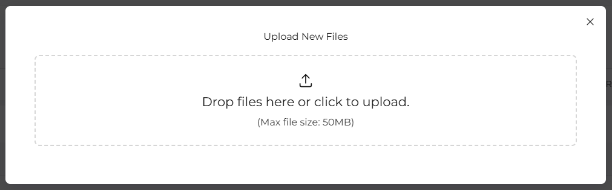
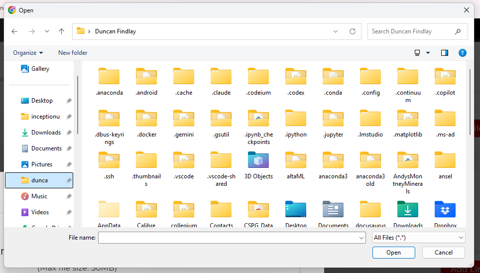
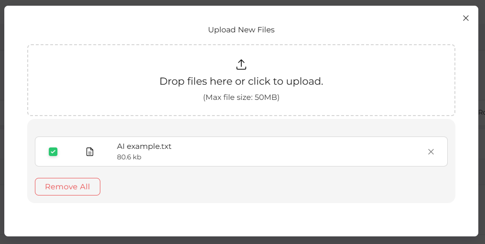
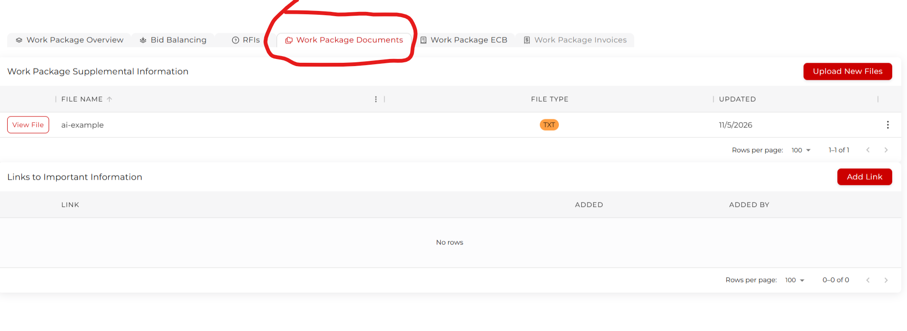
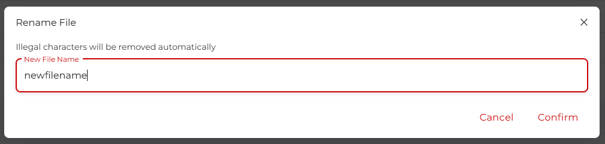

# Documents

In several places across the platform, document upload is necessary. You will need to upload supporting documents for a project, work package, bid, and Requests for Information (RFI). The process is similar each time, and detailed below.

## Uploading Documents

In every place where you need to upload documents, the upload tool is the same.

Here, you can:

1. Drag the file you wish to upload into the box with your mouse. It will be uploaded automatically.

2. Click within the box, and use your file explorer to select the file you wish to upload. Just find the file you're looking for and click **Open**.

Following upload, the file may appear below the upload box. You can click the x to remove a single document, or click **Remove All** to get rid of everything. Otherwise, close the window, file upload is complete.

## Managing uploaded files

In this example we will be using a work package, but it is the same process for projects as well.

Navigate to the **Work Packages Documents** tab, and look at the table.

You should be able to see the file name, file type, and when it was last updated. You can click **View File** to open the document in a new browser tab. Clicking the three-dot action button will let you view the file, **Delete** the file, or **Rename** the file.

Just edit the name, but be aware that you can only use lower case characters. Any illegal characters will be removed automatically. When you're happy, click **Confirm**
